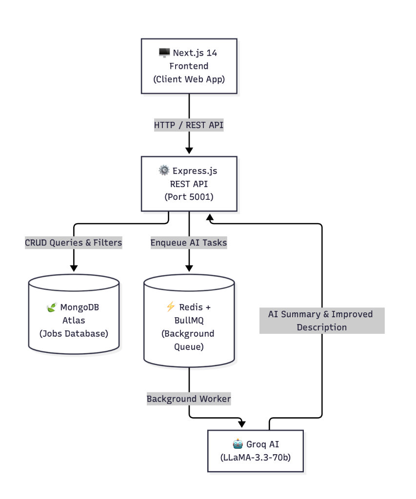

# 🚀 JobShuru — AI-Powered Job Management System

[](https://nextjs.org)
[](https://expressjs.com)
[](https://mongodb.com)
[](https://redis.io)
[](https://groq.com)
[](https://tailwindcss.com)

A production-grade, full-stack job discovery and publishing platform featuring a modern minimalist responsive interface, multi-field filtering, 10-job pagination, and integrated **Groq LLaMA-3.3 AI** assistance with background **BullMQ + Redis** queuing.

---

## 📋 Table of Contents

- [Live Production Links](#-live-production-links)
- [System Architecture](#-system-architecture)
- [Key Features](#-key-features)
- [Tech Stack](#-tech-stack)
- [Project Directory Structure](#-project-directory-structure)
- [Environment Configuration](#-environment-configuration)
- [Quickstart & Running Locally](#-quickstart--running-locally)
- [API Reference](#-api-reference)
- [Deployment Guide (Render & Vercel)](#-production-deployment-guide)
- [Assumptions & Guardrails](#-assumptions--guardrails)

---

## 🌟 Live Production Links

- 🌐 **Live Web Application**: [https://job-management-system-steel.vercel.app](https://job-management-system-steel.vercel.app)
- ⚙️ **Production Backend API**: [https://jobshuru-backend.onrender.com](https://jobshuru-backend.onrender.com)
- 🩺 **API Health Check**: [https://jobshuru-backend.onrender.com/api/health](https://jobshuru-backend.onrender.com/api/health)

---

## 🏗 System Architecture

<p align="center">
  
</p>

The system follows a clean modular architecture:
1. **Next.js 14 Client**: Renders the responsive full-screen UI, manages state, and communicates with the backend via a typed Axios client.
2. **Express.js Backend**: Exposes REST endpoints (`/api/jobs`, `/api/ai`), enforces Zod validation, Helmet security headers, rate limiting, and HTML sanitization.
3. **MongoDB Atlas**: Serves as the primary persistence layer storing job postings with indexed fields and compound filters.
4. **Redis + BullMQ**: Powers asynchronous task queuing (`ai-processing`) for reliable background processing.
5. **Groq LLaMA-3.3-70b**: Executes ultra-low-latency AI inference for job description enhancement and executive summarization.

---

## ✨ Key Features

- **Job Seeker Experience**:
  - Full-screen responsive landing page with quick search and metrics.
  - Multi-field filtering (title, company, category, workplace type, skills, and experience range).
  - 10-job pagination with automatic reset on filter updates.
  - Comprehensive job details view with sanitized HTML rendering.
  - Dedicated on-demand **"✨ AI Summary"** feature.

- **Employer / Recruiter Experience**:
  - Intuitive job creation form with conditional location fields (Country/City required for Hybrid/WFO; hidden for WFH).
  - Rich text description editor (React Quill) and interactive skills tag input.
  - **"✨ Improve with AI"** — non-destructive preview dialog allowing review before applying AI-enhanced copy.

- **Enterprise Reliability**:
  - AI keys kept securely server-side; zero secrets leaked to the client bundle.
  - Input sanitization via `sanitize-html` and `DOMPurify` to prevent XSS.

---

## 🛠 Tech Stack

- **Frontend**: Next.js 14 (App Router), React 18, TypeScript, Tailwind CSS, Lucide React, React Quill, DOMPurify.
- **Backend**: Node.js 18+, Express.js, Mongoose, Zod, sanitize-html, helmet, cors, express-rate-limit.
- **Database**: MongoDB Atlas (with local automated fallback for offline resilience).
- **Queue / Background Jobs**: BullMQ + Redis.
- **AI Inference**: Groq SDK (`llama-3.3-70b-versatile`).

---

## 📁 Project Directory Structure

```
job_management_system/
├── client/                     # Next.js 14 Frontend Application
│   ├── app/
│   │   ├── page.tsx            # Full-screen Landing Page (Hero, Search Capsule, Metrics)
│   │   ├── layout.tsx          # Root layout with persistent Navbar & Footer
│   │   ├── globals.css         # Inter font, Tailwind utilities, Quill styles
│   │   ├── jobs/
│   │   │   ├── page.tsx        # Find Jobs directory with FilterPanel & 10-job pagination
│   │   │   ├── [id]/page.tsx   # Job details with AI Summary button
│   │   │   └── new/page.tsx    # Post a Free Job form with AI Improve preview
│   ├── components/
│   │   ├── layout/             # Navbar, Footer
│   │   ├── jobs/               # JobCard, JobList, FilterPanel, Pagination
│   │   ├── forms/              # JobForm, RichTextEditor, SkillsInput, LocationFields
│   │   ├── ai/                 # AIImprovePanel, AISummaryPanel
│   │   └── ui/                 # Logo, Button, Badge, Spinner, Toast, Icons
│   ├── lib/api.ts              # Typed Axios API client
│   ├── types/job.ts            # TypeScript interfaces
│   └── .env.local              # Client environment config
│
├── server/                     # Express.js Backend REST API
│   ├── src/
│   │   ├── config/             # MongoDB & Redis connection handlers
│   │   ├── models/Job.js       # Strict Mongoose schema & validation
│   │   ├── controllers/        # Job & AI route handlers
│   │   ├── services/           # Query builder & Groq AI prompt services
│   │   ├── queues/             # BullMQ queue producer & background worker
│   │   ├── middlewares/        # Error handler, Rate limiter, Zod validator
│   │   ├── routes/             # /api/jobs and /api/ai routers
│   │   ├── seed.js             # 15 Hyderabad & Bangalore verified jobs seeder
│   │   └── index.js            # Express application entrypoint
│   └── .env                    # Server environment variables
│
├── docs/architecture.md        # Comprehensive technical architecture & design specs
└── README.md                   # Project documentation & deployment manual
```

---

## 🔑 Environment Configuration

### 1. Server Environment (`server/.env`)
```env
MONGODB_URI=mongodb+srv://<username>:<password>@cluster0.mongodb.net/job_management?retryWrites=true&w=majority
GROQ_API_KEY=gsk_your_groq_api_key_here
REDIS_URL=redis://localhost:6379
PORT=5001
NODE_ENV=development
CLIENT_URL=http://localhost:3000
```
> **Note on Port 5001**: Port `5001` is intentionally configured to avoid conflicts with macOS ControlCenter/AirPlay Receiver which reserves port `5000`.

### 2. Client Environment (`client/.env.local`)
```env
NEXT_PUBLIC_API_URL=http://localhost:5001
```

---

## ⚡ Quickstart & Running Locally

### Prerequisites
1. **Node.js**: v18.0.0 or higher
2. **Redis**: Installed and running (`redis-cli ping` → `PONG`)
3. **MongoDB**: Atlas connection string or local MongoDB instance

### Method 1: Start Everything with a Single Command
From the project root:
```bash
# 1. Install root, server, and client dependencies
npm run install:all

# 2. Seed 15 tech jobs in Hyderabad & Bangalore
npm run seed

# 3. Start both Backend (:5001) and Frontend (:3000) concurrently
npm run dev
```

### Method 2: Start in Separate Terminals
```bash
# Terminal 1 — Backend API
cd server
npm install
npm run seed
npm run dev

# Terminal 2 — Frontend App
cd client
npm install
npm run dev
```

Open **[http://localhost:3000](http://localhost:3000)** in your browser!

---

## 📡 API Reference

### Health Check
- `GET /api/health` → Returns `{ status: "ok", timestamp: "..." }`

### Job Management (`/api/jobs`)
| Method | Endpoint | Description |
|---|---|---|
| `GET` | `/api/jobs` | Query jobs with multi-field filtering & pagination |
| `GET` | `/api/jobs/:id` | Fetch complete single job record by ObjectId |
| `POST` | `/api/jobs` | Create a job posting (validated & HTML-sanitized) |

#### Filter Query Parameters
- `title` *(string)*: Case-insensitive search on title
- `companyName` *(string)*: Case-insensitive search on company
- `jobCategory` *(string)*: Exact match (Engineering, Design, Product, etc.)
- `locationType` *(enum)*: `WFH` \| `Hybrid` \| `WFO`
- `city` *(string)*: Search by city (e.g. Hyderabad, Bangalore)
- `skills` *(string)*: Comma-separated list (matches jobs containing any of the skills)
- `experienceMin` / `experienceMax` *(number)*: Experience range filter
- `page` *(number, default 1)* & `limit` *(number, default 10)*

### AI Integration (`/api/ai`)
| Method | Endpoint | Description |
|---|---|---|
| `POST` | `/api/ai/improve` | Submits draft description, returns polished version via Groq LLaMA-3.3 |
| `POST` | `/api/ai/summary` | Submits `jobId`, returns concise 2–3 sentence executive summary |

---

## 🌐 Production Deployment Guide

### Backend Deployment on Render

1. Sign up / Log in to [Render](https://render.com).
2. Click **New +** → **Web Service** and connect your GitHub repository `Rahul-pamula/job_management_system`.
3. Configure the service settings:
   - **Name**: `job-management-backend`
   - **Root Directory**: `server`
   - **Runtime**: `Node`
   - **Build Command**: `npm install`
   - **Start Command**: `npm start`
4. In **Environment Variables**, add:
   - `PORT`: `5001`
   - `NODE_ENV`: `production`
   - `MONGODB_URI`: Your MongoDB Atlas connection URI *(ensure 0.0.0.0/0 is whitelisted in Atlas Network Access)*
   - `GROQ_API_KEY`: Your Groq API key from [console.groq.com](https://console.groq.com)
   - `REDIS_URL`: Managed Redis URL (e.g., from [Upstash Redis](https://upstash.com) or Render Redis)
   - `CLIENT_URL`: `https://<your-app-name>.vercel.app`
5. Click **Create Web Service**. Once deployed, copy your service URL: `https://job-management-backend.onrender.com`.

---

### Frontend Deployment on Vercel

1. Log in to [Vercel](https://vercel.com).
2. Click **Add New...** → **Project** and import `Rahul-pamula/job_management_system`.
3. Configure project settings:
   - **Framework Preset**: `Next.js`
   - **Root Directory**: Click edit and select `client`
   - **Build & Development Settings**: Keep defaults (`next build`)
4. In **Environment Variables**, add:
   - **Key**: `NEXT_PUBLIC_API_URL`
   - **Value**: `https://job-management-backend.onrender.com` (your Render backend URL)
5. Click **Deploy**.
6. After deployment completes, copy your live Vercel URL and update `CLIENT_URL` in your Render backend settings.

---

## 🛡 Assumptions & Guardrails

1. **Authentication Excluded by Design**: In strict accordance with the assignment guidelines, authentication (login, registration, JWT sessions) is intentionally omitted. Protection is enforced via IP rate limiting and schema validation.
2. **AI Preview Requires Explicit User Approval**: Descriptions improved by AI never overwrite the editor silently; users must explicitly click **Apply** in the preview dialog.
3. **On-Demand AI Summary**: Summaries are generated on-demand and kept dynamic to ensure real-time accuracy.
4. **Security & Secrets**: Groq API keys and MongoDB connection strings exist exclusively on the server and are never bundled into client assets.
5. **Full-Viewport Visual Polish**: Layout avoids restrictive narrow container margins, delivering a modern full-screen experience matching top consumer products.
